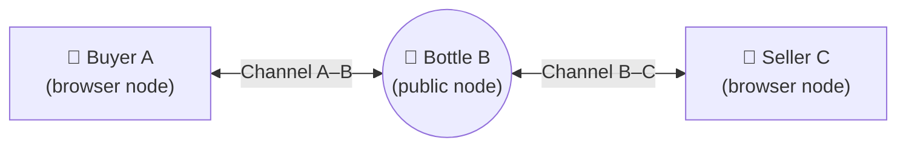
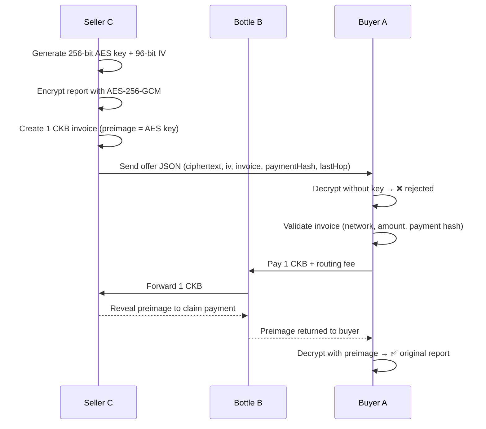

# 🔐 Unlock Encrypted Data with a Fiber Payment — Basic Quest

**CKBoost · Build on CKB: Campaign #8 · Quest 1 (Basic)**

A documented walkthrough of a pay-to-unlock flow on **CKB Testnet**, using two browser-based
[Fiber Network](https://fiber.world) nodes. A seller encrypts a report and issues an invoice;
a buyer pays **1 Testnet CKB**, and the payment itself reveals the key that unlocks the report.

| | |
|---|---|
| **Tutorial** | [Unlock Encrypted Data with a Fiber Payment](https://fiber.world/docs/build/encrypted-data-payment) |
| **Fiber version** | v0.10.1 |
| **Network** | CKB Testnet only |
| **Completed by** | [Your name / handle] |
| **Date** | [November 25, 2026] |

---

## 📑 Contents
1. [Overview](#-overview)
2. [How the flow works](#-how-the-flow-works)
3. [Step-by-step walkthrough](#-step-by-step-walkthrough)
4. [Run details](#-run-details)
5. [Key concepts](#-key-concepts)
6. [Experiments](#-experiments)
7. [Issues and how I resolved them](#-issues-and-how-i-resolved-them)
8. [Reflection](#-reflection)
9. [Safety](#-safety)

---

## 🧭 Overview

The tutorial runs three parties:

| Node | Role | Where it runs |
|---|---|---|
| **Buyer A** | Pays the invoice and decrypts the report | My browser (Fiber WASM) |
| **Bottle B** | Public Testnet node that forwards payments | Remote |
| **Seller C** | Encrypts the report and creates the invoice | My browser (Fiber WASM) |

Browser nodes can start connections but cannot accept them, so Buyer A and Seller C each open a
channel with Bottle B, which routes the payment between them.

---

## ⚙️ How the flow works

The core idea: **the AES decryption key is also the invoice's payment preimage.**
Seller C cannot collect the payment without revealing that secret, so paying and unlocking
happen in the same moment, with no backend and no trusted middleman.

---

## 🪜 Step-by-step walkthrough

### Step 1 — Setup: start nodes and open channels
- Started **Buyer A** and **Seller C** in the browser (Fiber WASM runtime, IndexedDB storage, WSS transport).
- Funded each node's own Testnet address from the CKB Testnet Faucet.
- Opened a channel from each node to **Bottle B** and waited for both to reach `CHANNEL_READY`.

Each channel moves through six opening states:
`NEGOTIATING_FUNDING` → `COLLABORATING_FUNDING_TX` → `SIGNING_COMMITMENT` →
`AWAITING_TX_SIGNATURES` → `AWAITING_CHANNEL_READY` → `CHANNEL_READY`

.png>)
*Both channels A–B and C–B showing `CHANNEL_READY`.*

### Step 2 — Encrypt and create the invoice
- As Seller C, entered my own sample text:
  > [Paste your sample text here]
- The browser generated a fresh 256-bit AES key and a random 96-bit IV, then encrypted the text with **AES-256-GCM**.
- Created a **1 CKB invoice** using the AES key as the payment preimage. The invoice's payment hash is the SHA-256 fingerprint of that key.

### Step 3 — Transfer the offer and try to decrypt without the key
- The encrypted offer was delivered to Buyer A as JSON containing `cipher`, `ciphertext`, `iv`, `invoice`, `paymentHash` and `lastHop`.
- Selected **Decrypt without key**. AES-GCM rejected the attempt: the buyer has the ciphertext and IV, but not Seller C's original key.

.png>)
*The encrypted offer on the buyer side and the "Decryption rejected" message.*

### Step 4 — Pay the invoice
- Before sending funds, Buyer A automatically checked the invoice's **network, amount and payment hash** against the offer.
- Paid 1 Testnet CKB through Bottle B.

.png>)
*Completed payment: 1 CKB received by Seller C, with the payment hash.*

### Step 5 — Decrypt the report
- Seller C revealed the preimage to claim the payment, and Fiber returned it to Buyer A.
- Selected **Decrypt result**: the preimage worked as the AES key and revealed the original text.

.png>)
*The buyer's decrypted result matches the seller's original sample text.*

---

## 📊 Run details

| Field | Value |
|---|---|
| Cipher | AES-256-GCM |
| IV | `0x41e0549d403e442847e9da17` |
| Payment hash | `0x5a1602091c29124a5b48298136cbf88eee8d82578b07f96a999fde64dea9ed7e` |
| Invoice amount | 1 CKB |
| Routing fee | [e.g. 0.001 CKB] |
| Total paid | [e.g. 1.001 CKB] |
| Time to fund nodes | [e.g. ~2 min] |
| Time for channels to reach `CHANNEL_READY` | [e.g. ~1 min] |

### Channel economics
| | Buyer A / Seller C | Bottle B |
|---|---|---|
| Contributed per channel | 500 CKB | 250 CKB |
| Reserved for on-chain settlement | 100 CKB | 100 CKB |
| Spendable | 400 CKB | 150 CKB |

Because Bottle forwards from its own balance on B–C, the route from A to C is limited to
**150 CKB before fees**. That is plenty for a 1 CKB invoice.

---

## 💡 Key concepts

- **Payment preimage as decryption key.** The same secret settles the payment and unlocks the data, so the buyer receives the key exactly when the seller gets paid.
- **Payment hash as fingerprint.** The invoice shows only the SHA-256 hash of the key. The buyer can check the revealed key against it after payment.
- **Authenticated encryption.** AES-GCM both hides the content and detects any change to it. A wrong key or altered ciphertext is refused outright rather than producing garbled text.
- **Inbound vs outbound liquidity.** Outbound is what you can send from your side of a channel; inbound is what you can receive. Seller C's inbound liquidity is Bottle's balance on B–C.
- **What payment does *not* guarantee.** Settlement proves the released key matches the ciphertext. It does not prove the report is accurate or useful. Real marketplaces need previews, seller reputation or dispute rules for that.

---

## 🧪 Experiments

### Optional liquidity transfer
Sent 5 CKB from Seller C to Bottle B to watch the B–C balance bar shift. No new CKB is created;
the same channel total simply moves from one side to the other.

### Tamper test
[Describe what you tried: e.g. changed one character of the ciphertext and attempted to decrypt.
What happened? Add `screenshots/5-tamper-test.png` if you captured it.]

---

## 🛠 Issues and how I resolved them

| # | Step | Expected | What happened | Resolution |
|---|---|---|---|---|
| 1 | Setup: liquidity bar | [ ] | [ ] | [ ] |
| 2 | [ ] | [ ] | [ ] | [ ] |

---

## ✍️ Reflection

<!-- Write this section in your own words — required by the campaign rules. -->

**How did it feel to have the explanations alongside each interactive step?**
[Your answer]

**What surprised you or stood out about paying to unlock the report?**
[Your answer]

**Was there a step where you were unsure what to do next or why it mattered?**
[Your answer]

**If you ran into a problem, what did you expect, what happened, and how did you resolve it?**
[Your answer]

**What would you like to build using this pay-to-unlock flow?**
[Your answer]

**If you could change one thing about the tutorial, what would it be?**
[Your answer]

---

## 🔒 Safety

- Testnet CKB only. No Mainnet funds were used at any point.
- No private keys, seed phrases, passwords or browser-storage contents are included in this repository or its screenshots.
- All values shown (IV, payment hash, invoice) are public Testnet data.

---

## 🔗 Links
- Tutorial: [Unlock Encrypted Data with a Fiber Payment](https://fiber.world/docs/build/encrypted-data-payment)
- Campaign: [CKBoost — Build on CKB: Campaign #8](https://ckboost.netlify.app/campaign/0x0846b87630f0c8cf2e4179bed0cf2b0dd0ed438b203a4be1129024465049cda9)
- Fiber Network docs: [fiber.world](https://fiber.world)
